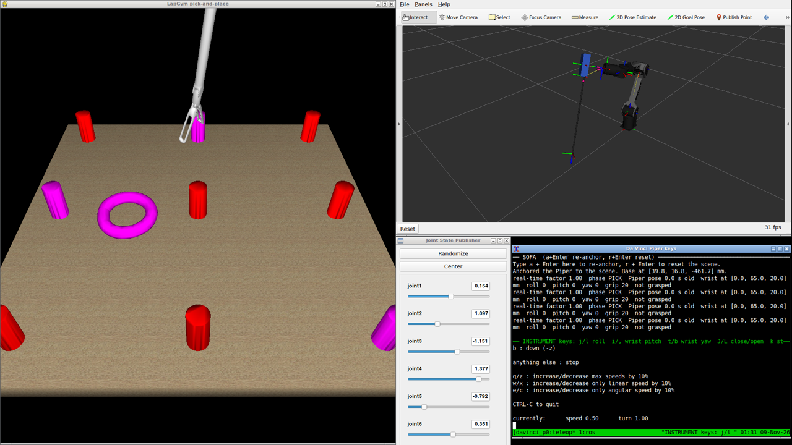
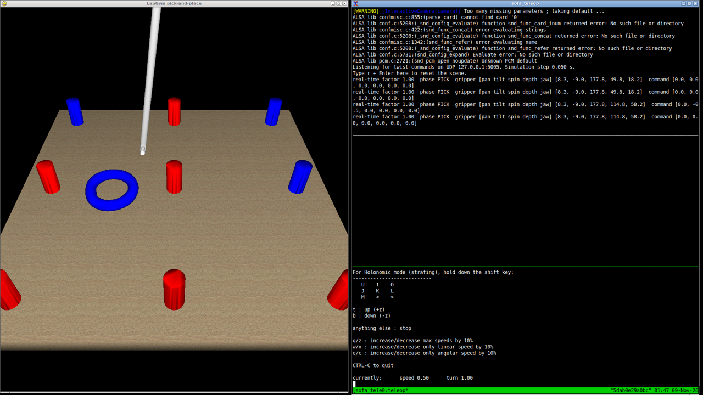

Kliknite u gornji desni kut za sadržaj ↗️

# Piper da Vinci simulacija
## Uvod
U ovom projektu ruka [AgileX Piper](https://github.com/agilexrobotics/agx_arm_ros/tree/ros2) preko adaptera drži instrument da Vinci Si, a simulator SOFA simulira kiruršku scenu iz LapGyma. Simulacija je napravljena kao privremena zamjena za stvarnog robota: na njoj možete razvijati i isprobavati upravljanje dok robot nije dostupan.

- **[SOFA](https://www.sofa-framework.org/)** je simulator otvorenog koda za medicinske simulacije. Računa deformacije mekih tkiva, sudare i dodir, pa se vidi kako instrument hvata i pomiče predmete.
- **[LapGym](https://github.com/ScheiklP/sofa_env)** (sofa_env) je skup scena za SOFA-u koje oponašaju laparoskopske zadatke, npr. premještanje prstenova i hvatanje tkiva na organu.
- **[ROS 2 Jazzy](https://docs.ros.org/en/jazzy/)** povezuje programe porukama na topicima, a **[RViz](https://docs.ros.org/en/jazzy/Tutorials/Intermediate/RViz/RViz-User-Guide/RViz-User-Guide.html)** prikazuje model ruke s adapterom i instrumentom.
- **[Docker](https://docs.docker.com/get-started/)** pakira sve to u jedan kontejner, pa na svoje računalo instalirate samo Docker (vidi [Postavljanje Dockera](#postavljanje-dockera)).

Slika sadrži odvojene dijelove:
- upravljački program (driver) za Pipera, kojim se stvarna ruka upravlja sliderima bez ikakvog dodatnog koda ([Stvarna ruka s driverom](#stvarna-ruka-s-driverom)),
- model ruke s adapterom i instrumentom, koji se u RViz-u pomiče sliderima ([Model ruke u RViz-u](#model-ruke-u-rviz-u)),
- SOFA s LapGym scenama, u kojoj se instrument upravlja tipkovnicom, bez ruke ([SOFA bez ruke](#sofa-bez-ruke)).

Ruka i simulacija nisu povezane: to povezivanje i upravljanje rukom vaš su zadatak ([Zadatak](#zadatak-povezivanje-ruke-i-simulacije)). Animacija ispod pokazuje kako to može izgledati kad je napravljeno.

[](media/demo.mp4)

> [!NOTE]
> Ako naiđete na problem, pogledajte [Issues](../../issues) ili otvorite novi issue s opisom, operacijskim sustavom i cijelim ispisom greške.

## Postavljanje Dockera
Docker u jedan kontejner pakira sve što je potrebno za simulaciju (ROS 2 Jazzy, SOFA, LapGym, upravljački program za Piper), pa ništa od toga ne morate instalirati na svoje računalo. Kontejner možete zamisliti kao lagani virtualni stroj. Slika (image) je predložak koji se izgradi jednom, a kontejner je primjerak slike koji pokrećete i u kojem radite.

Potrebni su Linux s grafičkim sučeljem (ili Windows, vidi [Windows (WSL2)](#windows-wsl2)) i oko 12 GB prostora na disku.

1. Instalirajte Docker engine prema [službenim uputama](https://docs.docker.com/engine/install/ubuntu/).
2. Slijedite [korake nakon instalacije](https://docs.docker.com/engine/install/linux-postinstall/#manage-docker-as-a-non-root-user) kako biste Docker mogli koristiti kao običan korisnik. Bez toga svaku `docker` naredbu morate pokretati sa `sudo`.

Više o Dockeru: [službena dokumentacija](https://docs.docker.com/get-started/), [LARICS Docker wiki](https://github.com/larics/docker_files/wiki).

### Windows (WSL2)
Na Windowsima se sve radi u Ubuntuu unutar [WSL2](https://learn.microsoft.com/en-us/windows/wsl/about) (Windows Subsystem for Linux). Potreban je Windows 11 ili Windows 10 verzija 21H2 ili novija, jer tek one mogu prikazivati prozore Linux programa ([WSLg](https://github.com/microsoft/wslg)).

1. Otvorite PowerShell kao administrator, instalirajte WSL2 s Ubuntuom 24.04 i ponovno pokrenite računalo ([upute](https://learn.microsoft.com/en-us/windows/wsl/install)):
   ```powershell
   wsl --install -d Ubuntu-24.04
   ```
2. Nakon ponovnog pokretanja otvorite **Ubuntu 24.04** iz izbornika Start i upišite korisničko ime i lozinku za Linux. Sve sljedeće naredbe upisujete u taj Ubuntu terminal.
3. U PowerShellu provjerite da Ubuntu radi pod WSL verzijom 2 (stupac `VERSION`) i ažurirajte WSL:
   ```powershell
   wsl -l -v
   wsl --update
   ```
4. U Ubuntu terminalu instalirajte Docker Engine i napravite korake nakon instalacije, isto kao na Linuxu (koraci 1 i 2 gore). Zatim instalirajte `xhost`, koji koristi `run_piper.sh`:
   ```bash
   sudo apt install -y x11-xserver-utils
   ```
5. Nastavite s [Instalacijom simulacije](#instalacija-simulacije) u Ubuntu terminalu. Repozitorij klonirajte u Ubuntu (npr. `cd ~`), a ne u Windows mapu pod `/mnt/c`, jer bi Git ondje mogao promijeniti završetke redaka u skriptama i one se onda ne bi pokretale.

WSL2 obično nema `/dev/dri`, pa RViz i SOFA crtaju softverski; to je sporije, ali dovoljno. Ako se prozori ne razmjeste sami, razmjestite ih mišem.

## Instalacija simulacije
```bash
git clone https://github.com/AntonioSkara132/piper_davinci_simulation.git
cd piper_davinci_simulation/docker
docker build -t piper-jazzy .
./run_piper.sh
```

`docker build` izgradi sliku `piper-jazzy`, a `run_piper.sh` iz nje stvori kontejner istog imena i otvori ljusku u njemu. Ponovnim pokretanjem `./run_piper.sh` otvarate novi terminal u istom kontejneru. Nakon ponovne izgradnje slike obrišite stari kontejner s `docker rm -f piper-jazzy`, inače i dalje radite u kontejneru iz stare slike.

## Pokretanje
### Model ruke u RViz-u
Unutar kontejnera:
```bash
ros2 launch /root/davinci_piper/davinci_piper.launch.py
```
Otvaraju se RViz s modelom ruke, adaptera i instrumenta i prozor sa sliderima zglobova `joint1` … `joint6`. Slideri objavljuju položaje zglobova na `/control/joint_states` i kreću iz poze u kojoj instrument stoji ispred ruke, s osovinom prema naprijed i dolje. `robot_state_publisher` iz njih računa TF, pa se pomiče i okvir `instrument_wrist` na vrhu instrumenta. S `arm:=none` slideri se ne pokreću i položaje objavljuje vaš program.



### SOFA bez ruke
```bash
run_sofa_teleop --rings
```
Pokreće scenu s prstenovima (pick-and-place) bez Pipera; bez `--rings` pokreće se scena s organom (grasp-lift-touch). Tipkovnica ([teleop_twist_keyboard](https://github.com/ros2/teleop_twist_keyboard) na `/robot/cmd_vel`) preko `twist_socket_bridge` šalje naredbe izravno LapGym hvataljci u SOFA-i. Kliknite na donje okno terminala prije tipkanja:

| Tipka | Hvataljka |
|---|---|
| `i` / `,` | nagib naprijed / natrag |
| `j` / `l` | zakret lijevo / desno |
| `t` / `b` | uvlačenje / izvlačenje (dubina) |
| `J` / `L` | zatvaranje / otvaranje čeljusti |
| `k` | stop |

U oknu SOFA-e `r` + `Enter` ponovno pokreće scenu. Sve radi u [tmux](https://github.com/tmux/tmux/wiki) sesiji `sofa_teleop` ([kratki uvod](https://github.com/tmux/tmux/wiki/Getting-Started), [popis naredbi](https://tmuxcheatsheet.com/)). Zaustavljanje:
```bash
tmux kill-session -t sofa_teleop
```



## Stvarna ruka s driverom
AgileX driver ([agx_arm_ros](https://github.com/agilexrobotics/agx_arm_ros/tree/ros2)) sam prima zadane položaje zglobova na `/control/joint_states` i objavljuje izmjerene na `/feedback/joint_states`. Položaje dalje regulira firmware Pipera, pa za upravljanje sliderima nije potreban nikakav naš kod. Kontejner (`run_piper.sh`) već radi s `--net=host --privileged`, pa vidi CAN sučelje računala.

1. Spojite ruku preko USB-CAN adaptera i u kontejneru aktivirajte CAN:
   ```bash
   cd ~/agx_arm_ws/src/agx_arm_ros/scripts && bash can_activate.sh
   ```
2. Pokrenite driver s RViz-om i sliderima:
   ```bash
   ros2 launch agx_arm_ctrl start_single_agx_arm_rviz.launch.py can_port:=can0 arm_type:=piper effector_type:=none follow:=true control:=true speed_percent:=10
   ```
   `control:=true` pokreće slidere koji objavljuju na `/control/joint_states`, a `follow:=true` u RViz-u prikazuje stvarnu ruku (`/feedback/joint_states`). Sa `control:=false` driver samo prikazuje ruku i ne pomiče je. Ovaj RViz prikazuje model Pipera bez adaptera.
3. Jedna naredba bez slidera, iz drugog terminala (pokrenite driver sa `control:=false`):
   ```bash
   cd ~/agx_arm_ws/src/agx_arm_ros
   ros2 topic pub /control/move_j sensor_msgs/msg/JointState "$(cat test/piper/test_move_j.yaml)" -1
   ```
4. Zaustavljanje u nuždi (ruka drži trenutnu pozu) i isključivanje motora:
   ```bash
   ros2 service call /emergency_stop std_srvs/srv/Empty
   ros2 service call /enable_agx_arm std_srvs/srv/SetBool "{data: false}"
   ```

Ostali topici i parametri drivera (`speed_percent`, `fast_mode`, `move_p`, `move_l` ...) opisani su u [njegovom README-u](https://github.com/agilexrobotics/agx_arm_ros/blob/ros2/README_EN.md).

Model s adapterom možete gledati i uz stvarnu ruku: pokrenite driver bez RViz-a (`ros2 launch agx_arm_ctrl start_single_agx_arm.launch.py can_port:=can0 arm_type:=piper speed_percent:=10`), a zatim `ros2 launch /root/davinci_piper/davinci_piper.launch.py follow:=true`. RViz tada prikazuje stvarnu ruku, a slideri je pomiču.

## Adapter i instrument
Model robota je [docker/davinci/piper_davinci.urdf.xacro](docker/davinci/piper_davinci.urdf.xacro) ([xacro](https://docs.ros.org/en/jazzy/Tutorials/Intermediate/URDF/Using-Xacro-to-Clean-Up-a-URDF-File.html), [URDF](https://docs.ros.org/en/jazzy/Tutorials/Intermediate/URDF/URDF-Main.html)). Uključuje službeni model Pipera iz `agx_arm_description` i na njegov zadnji link `link6` dodaje adapter i instrument fiksnim zglobovima:

```
link6 ── flange_link ── davinci_adapter ─┬─ instrument_housing
         (prirubnica)   (vaš adapter)    └─ instrument_shaft ── instrument_wrist
```

- **Adapter** nije uključen: model adaptera dodajete sami (vidi dolje). Dok ga ne dodate, RViz prikazuje instrument bez adaptera. Okvir `davinci_adapter` i pomaci instrumenta postavljeni su za [otvoreni adapter za da Vinci Si instrumente](https://github.com/Manaf2584/Open-Platform-adaptor-for-da-vinci-si-instruments): zglob `adapter_mount` podiže okvir adaptera za debljinu prirubnice (10.5 mm) i zakreće ga za 90° oko osi x.
- **Instrument** su procijenjeni kvadar (kućište) i valjak (osovina). Dimenzije su xacro svojstva na vrhu datoteke (`housing_size`, `shaft_length`, ...).
- **`instrument_wrist`** je okvir na kraju osovine. Os z gleda duž osovine, a os x je os zgloba čeljusti. Taj okvir treba povezati s instrumentom u SOFA-i (vidi [Zadatak](#zadatak-povezivanje-ruke-i-simulacije)).

### Dodavanje adaptera
1. Stavite STL svog adaptera u [docker/davinci/meshes/](docker/davinci/meshes), npr. `docker/davinci/meshes/moj_adapter.stl`. Dockerfile kopira tu mapu u `/root/davinci_piper/meshes/`.
2. U `piper_davinci.urdf.xacro`, u linku `davinci_adapter`, maknite oznake komentara oko bloka `<visual>` i upišite ime svoje datoteke. Ako je STL u metrima, a ne u milimetrima, stavite `scale="1 1 1"`.
   ```xml
   <link name="davinci_adapter">
     <visual>
       <geometry>
         <mesh filename="${mesh_dir}/moj_adapter.stl" scale="0.001 0.001 0.001"/>
       </geometry>
       <material name="adapter_grey"><color rgba="0.75 0.77 0.82 1"/></material>
     </visual>
     <inertial>
       ...
     </inertial>
   </link>
   ```
3. Promijenite `origin` zgloba `adapter_mount` tako da ploča adaptera leži na prirubnici: `xyz` je pomak, a `rpy` zakret (u radijanima) okvira vašeg CAD modela u odnosu na prirubnicu.
4. Promijenite svojstva instrumenta, a posebno `shaft_axis_y`, `shaft_start_z` i `shaft_length`, tako da `instrument_wrist` bude na vrhu vašeg instrumenta.
5. Provjerite model i pogledajte ga u RViz-u (u RViz-u uključite TF da vidite okvire):
   ```bash
   xacro /root/davinci_piper/piper_davinci.urdf.xacro > /tmp/robot.urdf && check_urdf /tmp/robot.urdf
   ros2 launch /root/davinci_piper/davinci_piper.launch.py
   ```

Dok isprobavate, datoteke možete mijenjati izravno u kontejneru (`/root/davinci_piper/`) ili ih kopirati s `docker cp`. Kad je model gotov, ponovno izgradite sliku. Ako je vaš instrument znatno duži ili kraći, promijenite početnu pozu slidera `READY_POSE` u [davinci_piper.launch.py](docker/davinci/davinci_piper.launch.py).

## Topici i TF
| Topic / okvir | Tip | Što je |
|---|---|---|
| `/control/joint_states` | `sensor_msgs/JointState` | zadani položaji zglobova `joint1` … `joint6` u radijanima; stvarnu ruku driver pomiče u njih |
| `/feedback/joint_states` | `sensor_msgs/JointState` | izmjereni položaji zglobova stvarne ruke, objavljuje ih driver |
| TF `base_link` → `instrument_wrist` | TF | poza vrha instrumenta, računa je `robot_state_publisher` iz položaja zglobova |
| `/robot/cmd_vel` | `geometry_msgs/Twist` | tipke hvataljke u `run_sofa_teleop`; `twist_socket_bridge` ih šalje SOFA-i kao UDP poruku `{"vel": [vx, vy, vz, wx, wy, wz]}` |

`davinci_piper.launch.py` prikazuje `/control/joint_states`, a s `follow:=true` `/feedback/joint_states`. Iz vlastitog programa rukom upravljate tako da launch pokrenete s `arm:=none` i sami objavljujete `JointState` na `/control/joint_states`, s trenutnim vremenom u `header.stamp`. Na primjer, iz drugog terminala u kontejneru:
```bash
ros2 topic pub -r 20 /control/joint_states sensor_msgs/msg/JointState \
  "{header: auto, name: [joint1, joint2, joint3, joint4, joint5, joint6], position: [0.154, 1.097, -1.151, 1.377, -0.792, 0.351]}"
```

## Zadatak: povezivanje ruke i simulacije
U slici postoje dva odvojena lanca:
```
slideri / vaš čvor ──/control/joint_states──> robot_state_publisher ──TF base_link → instrument_wrist
                                     └──> driver ──> stvarna ruka

tipkovnica ──/robot/cmd_vel──> twist_socket_bridge ──UDP──> SOFA (LapGym hvataljka)
```
Treba ih spojiti tako da instrument u SOFA-i prati okvir `instrument_wrist`, a stupnjevi slobode adaptera (roll, pitch i yaw zgloba, hvat) upravljaju se posebno. Za to je potrebno:
- čitati pozu `base_link` → `instrument_wrist` iz TF-a i slati je SOFA-i, npr. preko UDP-a kao `twist_socket_bridge`, jer SOFA radi u svom Python okruženju bez ROS-a;
- u SOFA-i postaviti bazu ruke u scenu i pomicati instrument prema primljenoj pozi;
- odvojeno slati naredbe za stupnjeve slobode adaptera. LapGym hvataljke u sceni s organom i u sceni s prstenovima prilagođene su za to (`sofa_env_sofa25.patch`): imaju zglob zapešća i čeljusti kojima se upravlja odvojeno.

Kad je to napravljeno, vlastito upravljanje radi jednako u simulaciji i na stvarnoj ruci, jer obje čitaju `/control/joint_states`.

### Prijedlozi za upravljanje
Nekoliko načina na koje se može napraviti upravljanje, od jednostavnijih prema složenijima. Svi na kraju objavljuju položaje zglobova na `/control/joint_states`.

- **Vlastiti čvor s položajima zglobova.** Najjednostavnije: čvor računa `joint1` … `joint6` (npr. putanju između nekoliko poza) i objavljuje ih.
- **Kartezijsko upravljanje vlastitom inverznom kinematikom.** Ulaz je željena brzina ili poza vrha instrumenta. Testni teleop [test/piper_cartesian_jog.py](test/piper_cartesian_jog.py) je jedno takvo rješenje (numerička IK, prigušeni najmanji kvadrati s geometrijskim Jacobianom iz URDF-a). Piper ima sferni zglob šake (osi `joint4`, `joint5` i `joint6` sijeku se u jednoj točki), pa se može napraviti i analitička IK (Pieperova metoda, [Inverse kinematics](https://en.wikipedia.org/wiki/Inverse_kinematics)).
- **Udaljeno središte gibanja (RCM).** Kod laparoskopije osovina mora stalno prolaziti kroz točku ulaza u tijelo (troakar). To je dodatni uvjet u inverznoj kinematici, npr. kao dodatni redovi Jacobiana ili zadatak nižeg prioriteta. Ovo je glavni zadatak koji gotovi alati ne rješavaju sami.
- **[MoveIt 2](https://moveit.picknik.ai/main/index.html) i [MoveIt Servo](https://moveit.picknik.ai/main/doc/examples/realtime_servo/realtime_servo_tutorial.html).** Servo iz `Twist` poruka u stvarnom vremenu računa pomake zglobova i pazi na granice i singularitete; MoveIt planira i putanje bez sudara. Treba napraviti MoveIt konfiguraciju za `piper_davinci.urdf.xacro` ([MoveIt Setup Assistant](https://moveit.picknik.ai/main/doc/examples/setup_assistant/setup_assistant_tutorial.html)) i izlaz Serva pretvoriti u `/control/joint_states`. Paket `ros-jazzy-moveit-servo` postoji u apt-u, ali još nije u slici.
- **[ros2_control](https://control.ros.org/jazzy/index.html) i [cartesian_controllers](https://github.com/fzi-forschungszentrum-informatik/cartesian_controllers).** Standardniji, ali složeniji put: treba napisati hardversko sučelje ros2_control za Piper (u projektu ga nema), a cartesian_controllers se gradi iz izvornog koda. Upravljanje silom iz tog paketa traži senzor sile i momenta, koji Piper nema.
- **Drugi ulazni uređaji.** Umjesto tipkovnice `Twist` može slati igraća palica ([teleop_twist_joy](https://github.com/ros2/teleop_twist_joy)), 3D miš ili haptički uređaj; ostatak lanca ostaje isti.

## Testni alati
Mapa [test](test) nije u slici. Sadrži alate kojima smo provjerili da se scene mogu voditi rukom: `run_davinci_piper` pokreće ruku, SOFA-u i vezu između njih, a `piper_cartesian_jog.py` pomiče vrh instrumenta tipkovnicom. Upute za instalaciju u kontejner i za pokretanje testova su u [test/README.md](test/README.md).

## Rad na projektu
Kod je u mapi [docker](docker). Driver za Piper nije u njoj: Dockerfile ga pri izgradnji slike klonira iz [AgileX repozitorija](https://github.com/agilexrobotics/agx_arm_ros/tree/ros2) u `/root/agx_arm_ws`. U driver nismo ništa dodavali niti smo ga mijenjali.

```
docker/
├── Dockerfile
├── run_piper.sh                  pokreće kontejner piper-jazzy na računalu
│
├── davinci/          → u kontejneru /root/davinci_piper/   (model ruke)
│   ├── piper_davinci.urdf.xacro  model: Piper + adapter + instrument
│   ├── meshes/                   ovdje stavljate STL svog adaptera
│   ├── davinci_piper.launch.py   robot_state_publisher, slideri, RViz
│   └── davinci_piper.rviz        postavke RViz-a
│
└── sofa/             → u kontejneru /opt/sofa_teleop/      (SOFA dio)
    ├── lapgym_keyboard_teleop.py upravljanje LapGym hvataljkom tipkama, prozor SOFA-e
    ├── twist_socket_bridge.py    /robot/cmd_vel → UDP prema SOFA-i
    ├── run_sofa_teleop.sh        naredba run_sofa_teleop
    ├── sofa-python               pokreće Python sa SOFA-om
    ├── sofa_env_sofa25.patch     prilagodba sofa_env za SOFA v25.12, zglob i čeljusti hvataljke
    └── smoke_test.py             provjera da se svih 14 LapGym scena pokreće

test/                 → nije u slici (vidi test/README.md)
```

SOFA skripte pokreću se sa `sofa-python`. Promjene unutar kontejnera brišu se s kontejnerom, pa mijenjajte datoteke u mapi `docker` i ponovno izgradite sliku.

## Licenca
[MIT](LICENSE). [sofa_env](https://github.com/ScheiklP/sofa_env) (MIT) preuzima se tijekom izgradnje slike.
