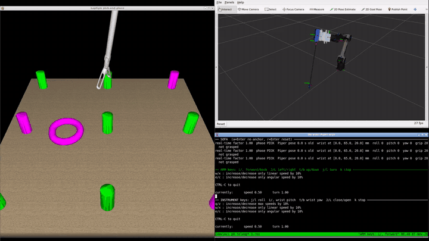
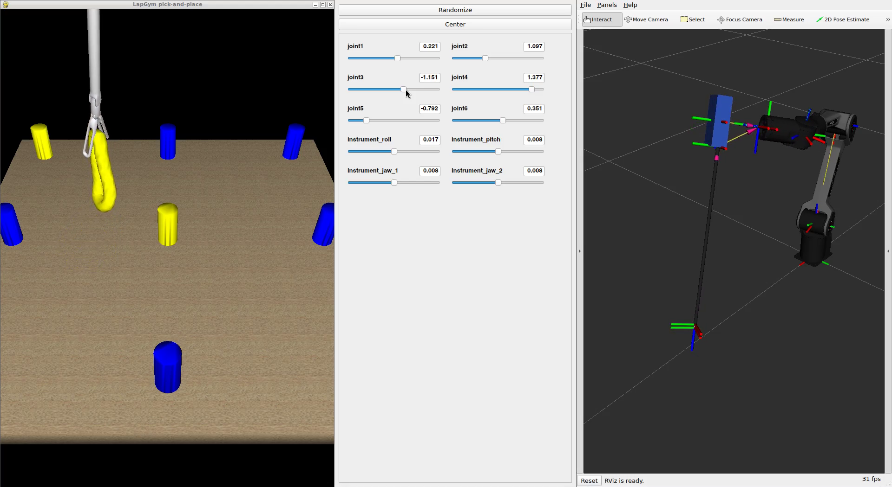

Kliknite u gornji desni kut za sadržaj ↗️

# Piper da Vinci simulacija
## Uvod
U ovom projektu ruka [AgileX Piper](https://github.com/agilexrobotics/agx_arm_ros/tree/ros2) preko adaptera drži instrument da Vinci Si, a simulator SOFA simulira kiruršku scenu iz LapGyma. Simulacija je napravljena kao privremena zamjena za stvarnog robota: na njoj možete razvijati i isprobavati upravljanje dok robot nije dostupan.

- **[SOFA](https://www.sofa-framework.org/)** je simulator otvorenog koda za medicinske simulacije. Računa deformacije mekih tkiva, sudare i dodir, pa se vidi kako instrument hvata i pomiče predmete.
- **[LapGym](https://github.com/ScheiklP/sofa_env)** (sofa_env) je skup scena za SOFA-u koje oponašaju laparoskopske zadatke, npr. premještanje prstenova i hvatanje tkiva na organu.
- **[ROS 2 Jazzy](https://docs.ros.org/en/jazzy/)** povezuje programe porukama na topicima, a **[RViz](https://docs.ros.org/en/jazzy/Tutorials/Intermediate/RViz/RViz-User-Guide/RViz-User-Guide.html)** prikazuje model ruke s adapterom i instrumentom.
- **[Docker](https://docs.docker.com/get-started/)** pakira sve to u jedan kontejner, pa na svoje računalo instalirate samo Docker (vidi [Postavljanje Dockera](#postavljanje-dockera)).

Slika sadrži:
- upravljački program (driver) za Pipera,
- model ruke s adapterom i instrumentom, koji se u RViz-u pomiče sliderima ([Model ruke u RViz-u](#model-ruke-u-rviz-u)),
- SOFA s LapGym scenama, u kojoj instrument prati okvire instrumenta iz TF-a ([Ruka u SOFA-i](#ruka-u-sofa-i)),
- SOFA s LapGym scenama u kojoj se instrument upravlja tipkovnicom, bez ruke ([SOFA bez ruke](#sofa-bez-ruke)).

Upravljanje rukom i adapterom vaš je zadatak ([Zadatak](#zadatak-upravljanje)). Animacija ispod pokazuje kako to može izgledati.

[](media/demo.mp4)

> [!NOTE]
> Ako naiđete na problem, pogledajte [Issues](../../issues) ili otvorite novi issue s opisom, operacijskim sustavom i cijelim ispisom greške.

## Postavljanje Dockera
Docker u jedan kontejner pakira sve što je potrebno za simulaciju (ROS 2 Jazzy, SOFA, LapGym, upravljački program za Piper), pa ništa od toga ne morate instalirati na svoje računalo. Kontejner možete zamisliti kao lagani virtualni stroj. Slika (image) je predložak koji se izgradi jednom, a kontejner je primjerak slike koji pokrećete i u kojem radite.

Potrebni su Linux s grafičkim sučeljem (ili Windows, vidi [Windows (WSL2)](#windows-wsl2)) i oko 12 GB prostora na disku.

1. Instalirajte Docker engine prema [službenim uputama](https://docs.docker.com/engine/install/ubuntu/).
2. Slijedite [korake nakon instalacije](https://docs.docker.com/engine/install/linux-postinstall/#manage-docker-as-a-non-root-user) kako biste Docker mogli koristiti kao običan korisnik. Bez toga svaku `docker` naredbu morate pokretati sa `sudo`.

Više o Dockeru: [službena dokumentacija](https://docs.docker.com/get-started/), [LARICS Docker wiki](https://github.com/larics/docker_files/wiki).

### Windows (WSL2)
Na Windowsima se sve radi u Ubuntuu unutar [WSL2](https://learn.microsoft.com/en-us/windows/wsl/about) (Windows Subsystem for Linux). Potreban je Windows 11 ili Windows 10 verzija 21H2 ili novija, jer tek one mogu prikazivati prozore Linux programa ([WSLg](https://github.com/microsoft/wslg)).

1. Otvorite PowerShell kao administrator, instalirajte WSL2 s Ubuntuom 24.04 i ponovno pokrenite računalo ([upute](https://learn.microsoft.com/en-us/windows/wsl/install)):
   ```powershell
   wsl --install -d Ubuntu-24.04
   ```
2. Nakon ponovnog pokretanja otvorite **Ubuntu 24.04** iz izbornika Start i upišite korisničko ime i lozinku za Linux. Sve sljedeće naredbe upisujete u taj Ubuntu terminal.
3. U PowerShellu provjerite da Ubuntu radi pod WSL verzijom 2 (stupac `VERSION`) i ažurirajte WSL:
   ```powershell
   wsl -l -v
   wsl --update
   ```
4. U Ubuntu terminalu instalirajte Docker Engine i napravite korake nakon instalacije, isto kao na Linuxu (koraci 1 i 2 gore). Zatim instalirajte `xhost`, koji koristi `run_piper.sh`:
   ```bash
   sudo apt install -y x11-xserver-utils
   ```
5. Nastavite s [Instalacijom simulacije](#instalacija-simulacije) u Ubuntu terminalu. Repozitorij klonirajte u Ubuntu (npr. `cd ~`), a ne u Windows mapu pod `/mnt/c`, jer bi Git ondje mogao promijeniti završetke redaka u skriptama i one se onda ne bi pokretale.

WSL2 obično nema `/dev/dri`, pa RViz i SOFA crtaju softverski; to je sporije, ali dovoljno. Ako se prozori ne razmjeste sami, razmjestite ih mišem.

## Instalacija simulacije
```bash
git clone https://github.com/AntonioSkara132/piper_davinci_simulation.git
cd piper_davinci_simulation/docker
docker build -t piper-jazzy .
./run_piper.sh
```

`docker build` izgradi sliku `piper-jazzy`, a `run_piper.sh` iz nje stvori kontejner istog imena i otvori ljusku u njemu. Ponovnim pokretanjem `./run_piper.sh` otvarate novi terminal u istom kontejneru. Nakon ponovne izgradnje slike obrišite stari kontejner s `docker rm -f piper-jazzy`, inače i dalje radite u kontejneru iz stare slike.

## Pokretanje
### Model ruke u RViz-u
Unutar kontejnera:
```bash
ros2 launch /root/davinci_piper/davinci_piper.launch.py
```
Otvaraju se RViz s modelom ruke, adaptera i instrumenta i prozor sa sliderima zglobova: `joint1` … `joint6` ruke i četiri zgloba adaptera:

| Zglob | Što pomiče |
|---|---|
| `instrument_roll` | okretanje osovine instrumenta oko svoje osi |
| `instrument_pitch` | pitch zgloba na kraju osovine (oko osi y) |
| `instrument_jaw_1`, `instrument_jaw_2` | čeljusti (oko osi x). Njihova srednja vrijednost je yaw zgloba, a pola razlike otvorenost čeljusti |

Slideri objavljuju položaje zglobova na `/control/joint_states` i kreću iz poze u kojoj instrument stoji ispred ruke, s osovinom prema naprijed i dolje, i čeljustima otvorenima 20° na svaku stranu. `robot_state_publisher` iz njih računa TF, pa se pomiču i okviri instrumenta. S `arm:=none` slideri se ne pokreću i položaje objavljuje vaš program.

Adapter i instrument opisani su u zasebnoj datoteci `davinci_adapter.urdf.xacro`, koju `piper_davinci.urdf.xacro` uključuje na prirubnicu ruke.


### Ruka u SOFA-i
```bash
run_davinci_piper --rings
```
Pokreće model ruke sa sliderima i scenu s prstenovima; bez `--rings` pokreće se scena s organom. Instrument u SOFA-i prati TF: `piper_tool_bridge` čita okvire instrumenta i šalje ih SOFA-i, pa se instrument pomiče sa sliderima ruke, a zglob i čeljusti sa sliderima adaptera. Baza ruke stoji na stalnom mjestu u sceni: u početnoj pozi slidera instrument je ondje gdje ga scena inače postavlja.



Opcije:
- `--no-arm`: bez slidera; položaje zglobova objavljuje vaš program,
- `--follow`: stvarna ruka (prvo pokrenite driver). Prikazuju se njezini izmjereni položaji, a slideri je pomiču,
- `--base X Y Z QX QY QZ QW`: drugo mjesto baze u sceni (mm i kvaternion).

U oknu SOFA-e `r` + `Enter` ponovno pokreće scenu. Zaustavljanje:
```bash
tmux kill-session -t davinci_piper
```

### SOFA bez ruke
```bash
run_sofa_teleop --rings
```
Pokreće scenu s prstenovima (pick-and-place) bez Pipera; bez `--rings` pokreće se scena s organom (grasp-lift-touch). Tipkovnica ([teleop_twist_keyboard](https://github.com/ros2/teleop_twist_keyboard) na `/robot/cmd_vel`) preko `twist_socket_bridge` šalje naredbe izravno LapGym hvataljci u SOFA-i. Kliknite na donje okno terminala prije tipkanja:

| Tipka | Hvataljka |
|---|---|
| `i` / `,` | nagib naprijed / natrag |
| `j` / `l` | zakret lijevo / desno |
| `t` / `b` | uvlačenje / izvlačenje (dubina) |
| `J` / `L` | zatvaranje / otvaranje čeljusti |
| `k` | stop |

U oknu SOFA-e `r` + `Enter` ponovno pokreće scenu. Sve radi u [tmux](https://github.com/tmux/tmux/wiki) sesiji `sofa_teleop` ([kratki uvod](https://github.com/tmux/tmux/wiki/Getting-Started), [popis naredbi](https://tmuxcheatsheet.com/)). Zaustavljanje:
```bash
tmux kill-session -t sofa_teleop
```


## Topici i TF
| Topic / okvir | Tip | Što je |
|---|---|---|
| `/control/joint_states` | `sensor_msgs/JointState` | zadani položaji zglobova ruke (`joint1` … `joint6`) i adaptera (`instrument_*`) u radijanima; stvarnu ruku driver pomiče u položaje `joint1` … `joint6`, a ostale zanemaruje |
| `/feedback/joint_states` | `sensor_msgs/JointState` | izmjereni položaji zglobova stvarne ruke, objavljuje ih driver |
| `/joint_states` | `sensor_msgs/JointState` | svi zglobovi zajedno, za `robot_state_publisher`; objavljuje ih `joint_state_merger` |
| TF `base_link` → `instrument_wrist` | TF | poza zgloba na kraju osovine (s rollom); z gleda duž osovine prema van, x je os čeljusti |
| TF `instrument_wrist` → `instrument_clevis` → `instrument_jaw_1`, `instrument_jaw_2` | TF | pitch zgloba i čeljusti |
| UDP 5006 | JSON | `piper_tool_bridge` → SOFA: `{"tool_pose": [x, y, z, qx, qy, qz, qw], "pitch": °, "jaws": [°, °]}`, poza u metrima u okviru `base_link` |
| `/robot/cmd_vel` | `geometry_msgs/Twist` | tipke hvataljke u `run_sofa_teleop`; `twist_socket_bridge` ih šalje SOFA-i kao UDP poruku `{"vel": [vx, vy, vz, wx, wy, wz]}` |

`joint_state_merger` uzima zglobove adaptera s `/control/joint_states`, a zglobove ruke s `/control/joint_states` ili, s `follow:=true`, s `/feedback/joint_states`. Zglob adaptera koji još nitko nije objavio ostaje u početnom položaju. Iz vlastitog programa upravljate tako da pokrenete `run_davinci_piper --no-arm` (ili launch s `arm:=none`) i sami objavljujete `JointState` na `/control/joint_states`, s trenutnim vremenom u `header.stamp`. Na primjer, iz drugog terminala u kontejneru:
```bash
ros2 topic pub -r 20 /control/joint_states sensor_msgs/msg/JointState \
  "{header: auto, name: [joint1, joint2, joint3, joint4, joint5, joint6, instrument_roll, instrument_pitch, instrument_jaw_1, instrument_jaw_2],
    position: [0.154, 1.097, -1.151, 1.377, -0.792, 0.351, 0.0, 0.3, 0.35, -0.35]}"
```

## Zadatak: upravljanje
```
slideri / vaš čvor ──/control/joint_states──> joint_state_merger ──> robot_state_publisher ──TF──> piper_tool_bridge ──UDP──> SOFA
                                     └──> driver ──> stvarna ruka
```
Sliderima se svaki zglob pomiče zasebno. Vaš je zadatak napisati čvor koji iz željenog gibanja vrha instrumenta računa položaje zglobova ruke i adaptera i objavljuje ih na `/control/joint_states`. Isti čvor tada radi i u simulaciji i na stvarnoj ruci, jer obje čitaju taj topic.

## Rad na projektu
Kod je u mapi [docker](docker). Driver za Piper nije u njoj: Dockerfile ga pri izgradnji slike klonira iz [AgileX repozitorija](https://github.com/agilexrobotics/agx_arm_ros/tree/ros2) u `/root/agx_arm_ws`. U driver nismo ništa dodavali niti smo ga mijenjali.

```
docker/
├── Dockerfile
├── run_piper.sh                  pokreće kontejner piper-jazzy na računalu
│
├── davinci/          → u kontejneru /root/davinci_piper/   (model ruke)
│   ├── piper_davinci.urdf.xacro  model: Piper + adapter
│   ├── davinci_adapter.urdf.xacro adapter i instrument s pomičnim zglobovima
│   ├── meshes/                   ovdje stavljate STL svog adaptera
│   ├── davinci_piper.launch.py   robot_state_publisher, joint_state_merger, slideri, RViz
│   ├── davinci_piper.rviz        postavke RViz-a
│   ├── joint_state_merger.py     spaja zglobove ruke i adaptera u /joint_states
│   ├── piper_tool_bridge.py      okviri instrumenta iz TF-a → UDP prema SOFA-i
│   ├── run_davinci_piper.sh      naredba run_davinci_piper
│   └── tile_windows.sh           slaže prozore
│
└── sofa/             → u kontejneru /opt/sofa_teleop/      (SOFA dio)
    ├── lapgym_keyboard_teleop.py upravljanje LapGym hvataljkom tipkama, prozor SOFA-e
    ├── davinci_piper_scene.py    scena u kojoj instrument prati okvire iz TF-a
    ├── twist_socket_bridge.py    /robot/cmd_vel → UDP prema SOFA-i
    ├── run_sofa_teleop.sh        naredba run_sofa_teleop
    ├── sofa-python               pokreće Python sa SOFA-om
    ├── sofa_env_sofa25.patch     prilagodba sofa_env za SOFA v25.12, zglob i čeljusti hvataljke
    └── smoke_test.py             provjera da se svih 14 LapGym scena pokreće

test/                 → nije u slici (vidi test/README.md)
```

SOFA skripte pokreću se sa `sofa-python`. Promjene unutar kontejnera brišu se s kontejnerom, pa mijenjajte datoteke u mapi `docker` i ponovno izgradite sliku.

## Licenca
[MIT](LICENSE). [sofa_env](https://github.com/ScheiklP/sofa_env) (MIT) preuzima se tijekom izgradnje slike.
