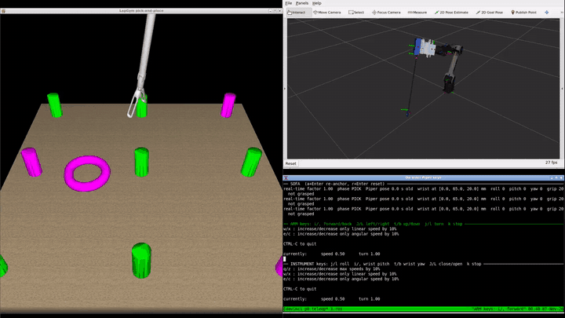

Click in the upper right corner for Table of Contents ↗️ | [Hrvatska verzija](README.md)

# Piper da Vinci Simulation
Simulation of an [AgileX Piper](https://github.com/agilexrobotics/agx_arm_ros/tree/ros2) arm holding a da Vinci Si instrument through an adaptor. The arm is shown in [RViz](https://docs.ros.org/en/jazzy/Tutorials/Intermediate/RViz/RViz-User-Guide/RViz-User-Guide.html) ([ROS 2 Jazzy](https://docs.ros.org/en/jazzy/)), and the instrument works in the [LapGym](https://github.com/ScheiklP/sofa_env) surgical scenes in the [SOFA](https://www.sofa-framework.org/) simulator.

[](media/demo.mp4)

> [!NOTE]
> If you run into a problem, check the [Issues](../../issues) or open a new one with a description, your operating system and the full error output.

> [!IMPORTANT]
> Tested in simulation only.

## Setting up Docker
Docker packs everything the simulation needs (ROS 2 Jazzy, SOFA, LapGym, the Piper driver) into one container, so none of it has to be installed on your computer. You can think of a container as a lightweight virtual machine. An image is a template you build once; a container is a copy of the image that you start and work in.

You need Linux with a desktop (or Windows, see [Windows (WSL2)](#windows-wsl2)) and about 12 GB of disk space.

1. Install the Docker engine following the [official instructions](https://docs.docker.com/engine/install/ubuntu/).
2. Follow the [post-installation steps](https://docs.docker.com/engine/install/linux-postinstall/#manage-docker-as-a-non-root-user) to use Docker as a normal user. Without them every `docker` command has to be run with `sudo`.

More on Docker: [official documentation](https://docs.docker.com/get-started/), [LARICS Docker wiki](https://github.com/larics/docker_files/wiki).

### Windows (WSL2)
On Windows everything runs in Ubuntu inside [WSL2](https://learn.microsoft.com/en-us/windows/wsl/about) (Windows Subsystem for Linux). You need Windows 11 or Windows 10 version 21H2 or newer, because only these can show the windows of Linux programs ([WSLg](https://github.com/microsoft/wslg)).

1. Open PowerShell as administrator, install WSL2 with Ubuntu 24.04 and restart the computer ([instructions](https://learn.microsoft.com/en-us/windows/wsl/install)):
   ```powershell
   wsl --install -d Ubuntu-24.04
   ```
2. After the restart, open **Ubuntu 24.04** from the Start menu and enter a Linux username and password. Type all the following commands in that Ubuntu terminal.
3. In PowerShell, check that Ubuntu runs under WSL version 2 (the `VERSION` column) and update WSL:
   ```powershell
   wsl -l -v
   wsl --update
   ```
4. In the Ubuntu terminal, install Docker Engine and do the post-installation steps, the same as on Linux (steps 1 and 2 above). Then install `xhost`, which `run_piper.sh` uses:
   ```bash
   sudo apt install -y x11-xserver-utils
   ```
5. Continue with [Installing the simulation](#installing-the-simulation) in the Ubuntu terminal. Clone the repository inside Ubuntu (e.g. `cd ~`), not in a Windows folder under `/mnt/c`, because Git there may change the line endings of the scripts and they would no longer run.

WSL2 usually has no `/dev/dri`, so RViz and SOFA render in software; this is slower but enough. If the windows do not arrange themselves, move them with the mouse.

## Installing the simulation
```bash
git clone https://github.com/AntonioSkara132/piper_davinci_simulation.git
cd piper_davinci_simulation/docker
docker build -t piper-jazzy .
./run_piper.sh
```

`docker build` builds the `piper-jazzy` image, and `run_piper.sh` creates a container with the same name from it and opens a shell in it. Running `./run_piper.sh` again opens another terminal in the same container. After rebuilding the image, remove the old container with `docker rm -f piper-jazzy`, otherwise you keep working in the container made from the old image.

## Running
Inside the container:
```bash
run_davinci_piper --rings
```
SOFA, RViz and a terminal with three panes open: SOFA messages, ARM keys and INSTRUMENT keys. Click the pane you want to type in. The keys work as in [teleop_twist_keyboard](https://github.com/ros2/teleop_twist_keyboard):

| Key | ARM keys | INSTRUMENT keys |
|---|---|---|
| `i` / `,` | tip forward / back | wrist pitch |
| `J` / `L` | tip left / right | close / open jaws |
| `t` / `b` | tip up / down | wrist yaw |
| `j` / `l` | turn about the vertical axis | roll |
| `k` | stop | stop |

In the SOFA pane, `r` + `Enter` resets the scene and `a` + `Enter` takes the arm's current pose as the new reference. Without `--rings` you get the organ scene.

Everything runs in the [tmux](https://github.com/tmux/tmux/wiki) session `davinci_piper` ([getting started](https://github.com/tmux/tmux/wiki/Getting-Started), [cheat sheet](https://tmuxcheatsheet.com/)). To stop:
```bash
tmux kill-session -t davinci_piper
```

## Adaptor and instrument
The robot model is [docker/davinci/piper_davinci.urdf.xacro](docker/davinci/piper_davinci.urdf.xacro) ([xacro](https://docs.ros.org/en/jazzy/Tutorials/Intermediate/URDF/Using-Xacro-to-Clean-Up-a-URDF-File.html), [URDF](https://docs.ros.org/en/jazzy/Tutorials/Intermediate/URDF/URDF-Main.html)). It includes the official Piper model from `agx_arm_description` and attaches the adaptor and the instrument to its last link `link6` with fixed joints:

```
link6 ── flange_link ── davinci_adapter ─┬─ instrument_housing
         (flange)       (your adaptor)   └─ instrument_shaft ── instrument_wrist
```

- **The adaptor** is not included: you add your adaptor's model yourself (see below). Until you do, RViz shows the instrument without an adaptor. The `davinci_adapter` frame and the instrument offsets are set for the [open-platform adaptor for da Vinci Si instruments](https://github.com/Manaf2584/Open-Platform-adaptor-for-da-vinci-si-instruments): the `adapter_mount` joint lifts the adaptor frame by the flange thickness (10.5 mm) and rotates it 90° about x.
- **The instrument** is an estimated box (housing) and cylinder (shaft). The dimensions are xacro properties at the top of the file (`housing_size`, `shaft_length`, ...).
- **`instrument_wrist`** is the frame at the end of the shaft. Its z axis points along the shaft and its x axis is the jaw hinge axis. This frame is the only link between the arm and SOFA: `piper_tool_bridge.py` sends its pose to SOFA, and the ARM keys move it.

### Adding your adaptor
1. Put your adaptor's STL in [docker/davinci/meshes/](docker/davinci/meshes), e.g. `docker/davinci/meshes/my_adapter.stl`. The Dockerfile copies that folder to `/root/davinci_piper/meshes/`.
2. In `piper_davinci.urdf.xacro`, in the `davinci_adapter` link, remove the comment markers around the `<visual>` block and put in your file name. If the STL is in metres rather than millimetres, use `scale="1 1 1"`.
   ```xml
   <link name="davinci_adapter">
     <visual>
       <geometry>
         <mesh filename="${mesh_dir}/my_adapter.stl" scale="0.001 0.001 0.001"/>
       </geometry>
       <material name="adapter_grey"><color rgba="0.75 0.77 0.82 1"/></material>
     </visual>
     <inertial>
       ...
     </inertial>
   </link>
   ```
3. Change the `origin` of the `adapter_mount` joint so the adaptor plate lies on the flange: `xyz` is the offset and `rpy` the rotation (radians) of your CAD frame relative to the flange.
4. Change the instrument properties, especially `shaft_axis_y`, `shaft_start_z` and `shaft_length`, so that `instrument_wrist` is at the tip of your instrument.
5. Check the model and look at it in RViz (enable TF in RViz to see the frames):
   ```bash
   xacro /root/davinci_piper/piper_davinci.urdf.xacro > /tmp/robot.urdf && check_urdf /tmp/robot.urdf
   run_davinci_piper --rings --sliders
   ```

While trying things out you can edit the files directly in the container (`/root/davinci_piper/`) or copy them in with `docker cp`. When the model is done, rebuild the image. The ARM keys read the model from `robot_description`, so they work with your adaptor without changes. If your instrument is much longer or shorter, change the starting pose `READY_POSE` in [piper_cartesian_jog.py](docker/davinci/piper_cartesian_jog.py), because the arm's reach depends on it.

## Topics and TF
```
ARM keys ──/piper/cmd_vel──> piper_cartesian_jog ──/control/joint_states──> robot_state_publisher ──TF──> piper_tool_bridge ──UDP──> SOFA
                             (inverse kinematics)                                                 (base_link → instrument_wrist)

INSTRUMENT keys ──/davinci/cmd_vel──> twist_socket_bridge ──UDP──> SOFA (roll, pitch, yaw, grip)
```

| Topic / frame | Type | What it is |
|---|---|---|
| `/piper/cmd_vel` | `geometry_msgs/Twist` | velocity of the instrument tip in the `base_link` frame: `linear` 0.5 = 40 mm/s, `angular.z` 1.0 = 0.25 rad/s of turning about the vertical axis |
| `/control/joint_states` | `sensor_msgs/JointState` | commanded positions of `joint1` … `joint6` in radians; the driver moves the real arm to them |
| `/feedback/joint_states` | `sensor_msgs/JointState` | measured joint positions of the real arm, published by the driver |
| `/davinci/cmd_vel` | `geometry_msgs/Twist` | INSTRUMENT keys (roll, pitch, yaw, grip); they go to SOFA only |
| TF `base_link` → `instrument_wrist` | TF | pose of the instrument wrist that SOFA follows |

RViz and SOFA show `/control/joint_states`, or `/feedback/joint_states` with `--follow`. To move the arm from your own program, either:

- publish a `Twist` on `/piper/cmd_vel`, the same as the ARM keys, or
- start `run_davinci_piper --rings --no-arm`, so the ARM keys are off, and publish `JointState` on `/control/joint_states` yourself, with the current time in `header.stamp`.

## Working on your project
The code is in the [docker](docker) folder: the ROS part in [docker/davinci](docker/davinci), the SOFA part in [docker/sofa](docker/sofa). The topics that move the arm are in [Topics and TF](#topics-and-tf). Run SOFA scripts with `sofa-python`. Changes inside the container are lost when it is removed, so edit the files in the `docker` folder and rebuild the image.

## License
[MIT](LICENSE). [sofa_env](https://github.com/ScheiklP/sofa_env) (MIT) is downloaded during the image build.
